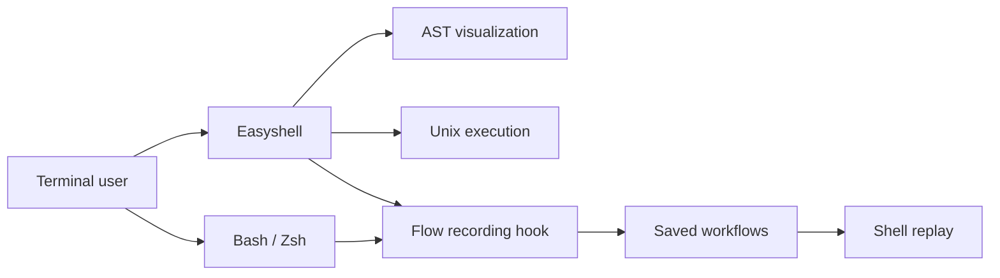
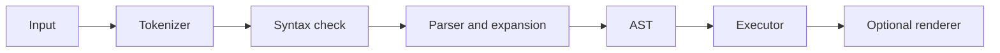
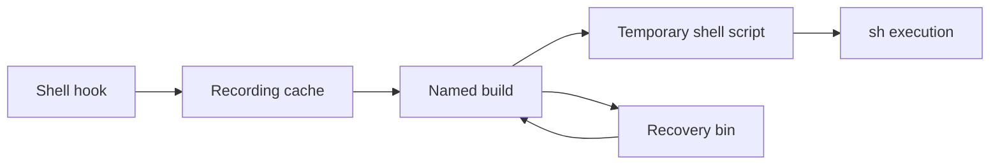

# Easyshell & Flow CLI

**Unix shell engineering · Visual command execution · Developer workflow automation**

  

A collection of personal systems programming projects exploring how Unix command execution can be made easier to understand and repetitive development workflows easier to reproduce.

**Easyshell** is an experimental shell with abstract syntax tree (AST) visualization. **Flow CLI** is a command recorder and workflow manager that turns terminal sessions into reusable command sequences. Both are written primarily in C and explore process management, parsing, file I/O and shell integration.

## Projects at a glance

| Project | Engineering focus | Explore |
|---|---|---|
| Easyshell | Lexical analysis, recursive parsing, Unix process execution, terminal visualization | [Source](./Easyshell/) |
| Flow CLI | Shell hooks, persistent workflows, command replay, file-based storage | [Source](./flow_utility/) · [Command reference](./flow_utility/flow_release/README.md) |



## 1. Easyshell — Visual Unix Shell

Easyshell combines a small Unix-style command interpreter with a visual representation of command structure. Instead of treating a command line as an opaque string, it tokenizes input, constructs an AST, executes the corresponding operations and optionally renders the tree in the terminal.

### Visual command execution

```sh
./easyshell
visual on
printf hello | wc -c && echo done
visual off
```

Illustrative AST structure (ANSI colors omitted):

```text
└── AND (&&)
    ├── [ printf hello ] -> [ wc -c ]
    └── [ echo done ]
```

The renderer uses ANSI color codes to distinguish successful commands, failures and commands marked as unexecuted. It also annotates input/output redirections and displays logical operators, subshells and background nodes.

A separate inspection mode renders the parsed tree without calling the AST executor:

```sh
./easyshell --ast 'echo hello | wc -c && echo done'
```

**Important:** inspection mode is not a safe dry run for arbitrary input. The parser currently opens redirection files and can process heredocs while constructing commands. Use non-destructive expressions for AST inspection.

### Implemented functionality

- Interactive GNU Readline prompt, command history and non-interactive input handling.
- Tokenization, quote-aware comment handling, syntax checking and environment expansion, including `$?`.
- Recursive AST construction for `&&`, `||`, parenthesized subshells and basic background execution (`&`).
- Pipelines and file redirections (`<`, `>`, `>>`, `<<`).
- Current-directory `*` wildcard matching.
- External command lookup and execution using Unix process APIs.
- Built-ins: `echo`, `cd`, `pwd`, `export`, `unset`, `env`, `exit`, `visual`, `clear`.
- Custom directory listing in visual mode and command completion using built-in candidates and PATH directories.
- Integration with the Flow recording hook for interactive input.

### Execution architecture



| Module | Responsibility |
|---|---|
| `src/core/` | Shell loop, input, signals and recording integration |
| `src/lexer/` | Tokenization, expansion, syntax checks and wildcard matching |
| `src/parser/` | AST nodes, pipeline parsing and command structures |
| `src/executor/` | AST evaluation, pipelines, PATH resolution, redirects and heredocs |
| `src/env/` | Environment linked-list operations |
| `src/builtins/` | Internal shell commands and visual directory listing |
| `src/render/` | Recursive terminal AST rendering |
| `src/ui/` | Readline completion |
| `src/utils/` | String and input helpers |

The AST executor uses the previous exit status to decide whether to evaluate the right branch of `&&` or `||`. Pipelines connect process input and output through file descriptors; subshells execute in forked processes. Standalone state-changing built-ins are handled separately from external commands.

## 2. Flow CLI — Workflow Recording and Replay

Flow addresses repetitive terminal work such as rebuilding projects, running regression tests and preparing development environments. A sequence of commands can be recorded once, edited, saved as a named build and reused later.

Version in this source snapshot: **0.1.0-beta**.

### Example workflow

After installing the executable and shell hooks, run these commands in an interactive Bash or Zsh session:

```sh
flow start
make
./my_program
flow stop
flow list
flow build regression
flow run regression
```

The build stores command text and directory context, not a compiled application. Workflows can contain any trusted commands compatible with the replay shell.

### Workflow management

| Command | Purpose |
|---|---|
| `flow start` / `flow stop` | Control recording |
| `flow list` | Inspect current workspace |
| `flow list build` | List named builds |
| `flow list regression` | Inspect a saved workflow |
| `flow build regression` | Save the workspace |
| `flow run regression` | Replay a named build |
| `flow run regression -l` | Skip recorded directory setup |
| `flow run regression 0,2` | Replay workflow and show selected step output |
| `flow append regression "echo done"` | Append a command |
| `flow insert regression 1 "echo start"` | Insert a command at a zero-based index |
| `flow delist regression 1` | Remove a command step |
| `flow copy regression backup` | Duplicate a workflow |
| `flow join regression backup combined` | Combine two builds |
| `flow remove backup` | Move a build to the recovery bin |
| `flow list bin` | Inspect removed builds |
| `flow bin restore 0` | Restore a removed build |

**Replay semantics:** index selection controls which steps display output, not which commands execute. Unselected steps still run with output redirected. This preserves preceding setup operations but must not be mistaken for selective or sandboxed execution. Running a named build also loads it into the current workspace.

### Recording and replay architecture



- Bash and Zsh installation scripts create hooks that forward command strings to `flow _hook`.
- The C storage subsystem maintains recording state, workspace contents, named builds and the recovery bin.
- The replay engine constructs a temporary shell script, restores recorded directory context unless `-l` is supplied, executes it through `sh`, then removes the wrapper.
- Replaying commands in one shell script allows earlier directory changes to affect subsequent commands.

### Local storage

| Location | Purpose |
|---|---|
| `~/.flow_macros/` | Saved named workflows |
| `~/.flow_macros/.bin/` | Recovery bin |
| `~/.flow/hooks/` | Bash and Zsh hook scripts |
| `/tmp/.flow_record_cache` | Current workspace |
| `/tmp/.flow_active_state` | Recording flag |
| `/tmp/.flow_recorded_path` | Recording start directory |
| `/tmp/.flow_execution_wrapper.sh` | Generated replay script |

## Build and setup

```sh
git clone https://github.com/linthantkyaw2002/my_own_project.git
cd my_own_project
```

### Flow CLI

Requires a C compiler, Make and a Unix-like environment. For command capture, use Bash or Zsh.

```sh
cd flow_utility
make
./flow --version
```

The installer expects the compiled binary beside itself. After a successful build:

```sh
cp flow flow_release/flow
cd flow_release
bash install.sh
# Restart the shell, or use exec bash / exec zsh as appropriate.
flow --version
```

The installer modifies shell startup configuration and normally installs to `/usr/local/bin`. Review it before running. `make install` installs only the executable, not the recording hooks. See the [release documentation](./flow_utility/flow_release/README.md) for uninstallation and the complete command reference.

### Easyshell (macOS-oriented build)

```sh
# From the repository root
brew install readline
cd Easyshell
make
./easyshell
```

The Makefile uses Homebrew to discover GNU Readline. The repository includes a precompiled `libft.a` but not the library's full source/build files. The archive must be compatible with the target architecture and OS; otherwise supply a compatible build of Libft. Linux additionally requires Readline development headers and suitable Makefile configuration (for example `READLINE_DIR=/usr` where appropriate).

### Build verification status

In a Linux source review, Flow's default build stopped on GCC `-Werror=format-truncation` warnings in two temporary-path constructions. Easyshell's build stopped because Readline development headers were unavailable in the review environment. Neither result establishes a successful end-to-end build on that environment. The examples above describe intended usage, not a newly verified runtime demonstration.

## Engineering limitations and next steps

Both projects are experimental; they are not replacements for production shells or isolated automation runners.

| Area | Current limitation | Proposed improvement |
|---|---|---|
| AST inspection | Redirections and heredocs can have parse-time side effects | Separate syntax representation from execution and resource acquisition |
| Shell integration | Easyshell interpolates input into a `system()` command for the Flow hook | Pass literal arguments using process APIs instead of shell interpolation |
| Job control | Basic background execution without full job management | Process groups, terminal ownership and child reaping |
| AST status | Nodes initialized to success may not distinguish all skipped branches | Explicit unexecuted state and propagated status |
| Completion | Candidate list includes `explain`, which is not dispatched as a built-in; PATH entries are not checked for executable permissions | Share dispatch metadata and validate candidates |
| Replay | Commands execute via `sh`; Bash/Zsh-specific syntax may fail | Explicit interpreter selection and compatibility checks |
| Replay safety | Generated scripts interpolate command text into status messages and directory commands without robust escaping | Safe logging and quoting; preserve command semantics |
| Replay status | Wrapper `system()` return value is not propagated to the CLI | Structured execution results and optional fail-fast behavior |
| Storage | Fixed `/tmp` paths can collide across sessions and pose local security risks | Private per-user runtime directories, secure temporary files and locking |
| Portability | Prebuilt Libft and compiler-specific warnings | Reproducible dependency builds and CI on macOS/Linux |

Review workflows before replaying them; commands can modify the filesystem or other systems with the invoking user's permissions. Avoid recording secrets. Easyshell's current hook interpolation should be fixed before relying on it with arbitrary input. Do not assume the recovery bin protects files changed by executed commands.

## Repository structure

```text
my_own_project/
├── README.md
├── Easyshell/
│   ├── Makefile
│   ├── includes/
│   ├── libft/
│   └── src/
│       ├── core/  env/  lexer/  parser/
│       ├── executor/  builtins/  render/
│       └── ui/  utils/
└── flow_utility/
    ├── Makefile
    ├── includes/
    ├── src/
    │   ├── core/
    │   └── storage/
    └── flow_release/
        ├── README.md
        ├── LICENSE
        ├── install.sh
        └── uninstall.sh
```

## Author and licensing

Developed by **Lin Thant Kyaw** as personal systems programming and developer tooling projects.

Flow's supplied [Beta License](./flow_utility/flow_release/LICENSE) permits personal testing and evaluation and restricts redistribution, modification and commercial use. Public source visibility does not itself make the project open source. No separate Easyshell license is included in this snapshot.
